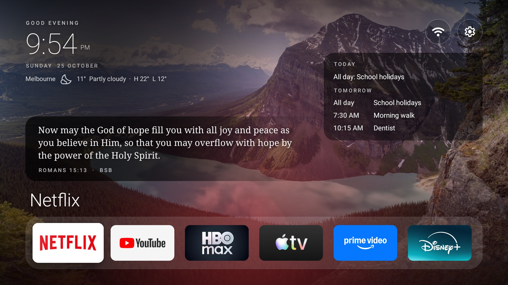
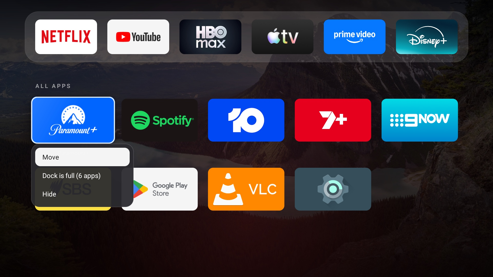

# tv-home for the Mi Box S

A small, fast home screen for Android TV, set up for a Xiaomi Mi Box S (2 GB, Android 9). It
replaces the stock launcher with a clock, the weather, today's schedule, a verse of the day and a
dock of your apps over slowly changing nature and city photos. No ads, no recommendations, no
background services.

*Sample data on a Xiaomi Mi Box S: made-up calendar events, fixed weather and the bundled BSB verse.*

*The real Mi Box S running the sample-data build: the All Apps grid with an app's long-press menu.
The menu shows the dock cap ("Dock is full (6 apps)").*

*Wallpaper in both: "1 lake louise pano 2019" by Chensiyuan,
[CC BY-SA 4.0](https://creativecommons.org/licenses/by-sa/4.0/), resized and cropped
([source](https://commons.wikimedia.org/wiki/File%3A1_lake_louise_pano_2019.jpg)).*

## Built from

This started as [tv-home](https://github.com/mihirgupta0900/tv-home) by Mihir Gupta (MIT licence),
which debloats an Android TV over Wi-Fi and installs a minimal Apple TV-style launcher. This fork
builds the launcher for API 28 and adds the schedule, verse, weather icon, dock editing and the
design work described below. It was built with [Claude Code](https://claude.com/claude-code).
Upstream was in turn inspired by [Gathin23/tv-vibehack](https://github.com/Gathin23/tv-vibehack).

## Features

- **Home screen:** clock, greeting and date top-left; Wi-Fi and Settings buttons top-right (the
  Wi-Fi icon shows working, no internet, connecting, off or Ethernet); the remote's Menu key opens
  an Inputs list. 12 nature and city photos crossfade every 10 minutes.
- **Dock:** up to 6 favourite apps; the focused app's name shows above it. Press Down for every other
  app, plus Settings, in a grid.
- **Move and hide:** long-press OK on an app to move it, add it to or remove it from the dock, or
  hide it. Hidden apps can be shown again from the Settings tile's menu. Orders are saved on the box.
- **Verse of the day:** the day's reference from YouVersion's verse of the day, shown in the ESV. A
  range too long for the card shows its first verse. Without the keys, or on any failure, it uses a
  bundled list of 30 verses in the public-domain Berean Standard Bible (BSB). Crossway's copyright
  notice and www.esv.org show along the bottom edge while ESV text is on screen.
- **Weather:** the current temperature and an icon and words for the day's forecast (clear, partly
  cloudy, cloudy, fog, rain, storms, snow, or windy from the day's gusts), from Open-Meteo.
- **Schedule:** today's remaining events (or tomorrow's first ones) from up to three Google Calendar
  private iCal links, cached for offline use and marked as stale after 3 hours.

Everything on screen except the dock, grid and the two buttons is display only. Network requests
happen only while the home screen is in front, and each source retries failures on a slow schedule.

## Design rules

The launcher follows the rules in [CLAUDE.md](CLAUDE.md), written for a TV seen from about 3 metres
on a weak 2 GB box. In short: a 48 dp safe margin and an 8 dp grid; at least 4.5:1 text contrast;
one accent colour; an unmistakable but calm focus state; short, purposeful motion; no blur or heavy
shadows; Material Symbols line icons; and fewer elements rather than more. It also records the
rules found by testing, such as how to keep vector icons sharp and to check visuals on a true
1920×1080 emulator with the real wallpapers.

## What I measured

- **Memory:** typically 22 to 27 MB on a 2 GB Mi Box S (the TOTAL line of dumpsys meminfo for the
  launcher process, read over adb on the box itself on 22 and 23 October 2026; one transient
  reading was about 31.7 MB). Emulator numbers are not comparable and are not used.
- **Text contrast:** the text on the home screen (greeting, clock, date, weather, schedule, verse
  and dock title) was measured on screenshots of all 12 wallpapers at 1920×1080, with the
  background taken from the middle of the luminance range behind each label. All of it passes
  4.5:1 on every wallpaper (3:1 for the large clock and dock title). The lowest are the date (4.58:1), the calendar's TODAY
  and TOMORROW labels (4.93:1) and the stale-calendar note (5.24:1). The weather icon is at least
  6.75:1. The calendar labels were raised from 60% to 70% white after the TOMORROW label, shown
  when nothing is left today, measured 4.09:1 on one wallpaper.
- **Sharp icons:** the round Wi-Fi and Settings buttons used to leave their icon slightly blurred
  after being focused, because the icon was resized. Each button now stacks a 48 px and a 52 px copy
  of the icon that are never resized or scaled, and crossfades between them, so the icon is as crisp
  after a focus-and-leave as on a fresh start.

These were checked on the `tvtest_1080p` Android emulator (a native 1920×1080 panel at density 320,
like the Mi Box) using fixture data. The live ESV, YouVersion, Open-Meteo and calendar requests have
not all been exercised on the emulator, and how it looks from the couch can only be judged on a TV.

## Build it with your own keys

Requires macOS. `./setup.sh` installs JDK 17, the Android SDK pieces and a Python ADB client. Then:

1. Put your keys in these files under `launcher/`. All three are git-ignored, and the build compiles
   them in without printing them. Never commit or share them.

   | File | Line | What it's for |
   |---|---|---|
   | `esv.env` | `ESV_API_KEY=<key>` | ESV text, from [api.esv.org](https://api.esv.org/) (non-commercial use only) |
   | `esv.env` (optional) | `SHOW_ESV_NOTICE=false` | Hides Crossway's notice on your build. The ESV API terms require the notice with the text, so hiding it is your own responsibility. |
   | `youversion.env` | `YOUVERSION_APP_KEY=<key>` | The daily reference, from an app you create at [platform.youversion.com](https://platform.youversion.com/), for a personal, non-commercial launcher |
   | `calendar.env` | `ICAL_URL_1=<link>` to `ICAL_URL_3=` | Google Calendar's "secret address in iCal format" links |

   Any of them can be left out: without the ESV key the verse is the bundled BSB, without the
   YouVersion key the reference comes from the bundled list, and without calendar links the card
   says "Calendar not set up".
2. Set your dock, weather location and time zones in
   [launcher/res/values/config.xml](launcher/res/values/config.xml).
3. Build: `launcher/build-and-install.sh --build`. It prints whether each key was found (never the
   key) and whether the ESV notice is shown. Without `--build` it also installs on the TV found by
   `tools/find-tv.sh` and sets it as the home app.

An optional, git-ignored `launcher/wallpapers-private/` folder of 1920×1080 photos overrides the
bundled wallpapers on your own build; the build then prints "Wallpapers: private (N)".

`scripts/yv-check.sh` checks your YouVersion key by hand: it prints today's verse of the day and
its BSB text, without printing the key.

## Debloating (from upstream)

Upstream's scripts can disable a TV's ads, telemetry and preinstalled apps over Wi-Fi, reversibly
(`tools/disable.sh <list>`, undone by `tools/restore.sh <list>`), with example lists in
[examples/](examples/). Upstream reports cutting a 2 GB TCL Google TV's home screen memory from
192 MB to 83 MB. I haven't used them on the Mi Box; this fork only replaces the home screen. See
upstream's README and [PROMPT.md](PROMPT.md) for that workflow and the gotchas it hit, such as macOS
blocking the `adb` binary (hence the pure-Python `tools/tv.py`) and Google TV's setup app taking
over the Home button.

## What's here

| Path | What it is |
|---|---|
| [launcher/](launcher/) | The home screen: plain Android, built with the SDK tools, no Gradle |
| [launcher/res/values/config.xml](launcher/res/values/config.xml) | Dock, hidden apps, grid, weather location, verse and calendar settings |
| [CLAUDE.md](CLAUDE.md) | The design rules |
| [scripts/yv-check.sh](scripts/yv-check.sh) | By-hand check of the YouVersion key |
| [tools/](tools/) | Upstream's ADB tools: find the TV, shell, screenshots, debloat and restore |
| [examples/](examples/) | Upstream's debloat lists per TV model |

## Licence and credits

- The code is MIT, see [LICENSE](LICENSE): copyright Mihir Gupta for upstream's work, which this
  fork keeps under the same licence.
- The wallpaper photos are from Wikimedia Commons under CC BY-SA licences (one is CC0), resized
  and in most cases cropped to 1920×1080; authors and licences are in
  [launcher/WALLPAPER-CREDITS.md](launcher/WALLPAPER-CREDITS.md).
- Icons are Material Symbols (Apache License 2.0). Weather data by
  [Open-Meteo.com](https://open-meteo.com/) (CC BY 4.0). Daily verse references from YouVersion
  Platform. Fallback verses: Berean Standard Bible, public domain. ESV text © Crossway, fetched with
  your own key and never stored in this repository. Details and the full Apache 2.0 text are in
  [THIRD-PARTY-NOTICES.md](THIRD-PARTY-NOTICES.md).
- Netflix, YouTube, HBO Max, Apple TV, Prime Video, Disney+ and other app names and logos are
  trademarks of their owners and appear only to show which apps the dock holds. This project is not
  affiliated with or endorsed by them.
